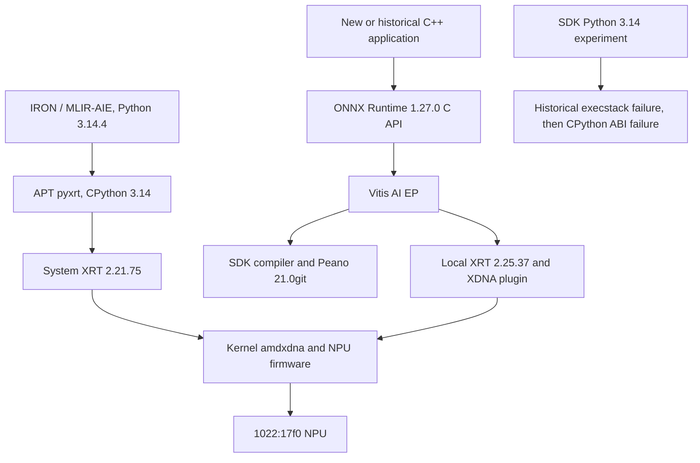

# Runtime architecture

The preserved host supports two distinct development paths. Their Python environments, Peano toolchains and XRT selection must remain separate.

This diagram follows current static artifacts plus preserved execution evidence. It is not a claim that every edge has passed an independent integration test.

- **Verified:** E035 uses the ONNX Runtime C API from C++, creates `OrtEnv` before EP registration, creates a session and calls `Run`. C++ avoids the failing SDK Python extension import.
- **Verified:** `libonnxruntime_vitisai_ep.so` depends on the compiler, VAIML and Dynamic Dispatch libraries; the compiler graph requires SDK Peano. `libvaiml2.so` uses an RPATH; several EP libraries have no RUNPATH. See [the static graph](../artifacts/static-analysis.json).
- **Verified:** current IRON venv has a symlink to the system cp314 pyxrt module. This addresses module visibility for this interpreter ABI, not compatibility with SDK Python extensions.
- **Verified historical log:** 398 NPU operators, 2 VITIS_EP_CPU operators and one NPU subgraph are reported in E098, which later prints inference PASS. CPU work remains part of the application.
- **Unknown:** output numerical error and application accuracy. The historical quicktest never compares values.

The model file has 386 top-level ONNX nodes; runtime partition reports 400 operators and a lower-level graph can report another count. Compiler transformations and representation boundaries differ. These counts must not be treated as interchangeable, as a timing split, or as 99.5% NPU utilization.

The historical 51 TOPS diagnostic, IRON memcpy bandwidth, and ONNX quicktest exercise different layers. Success at an earlier layer narrows hardware/driver hypotheses but cannot establish that the next runtime stack is compatible.
